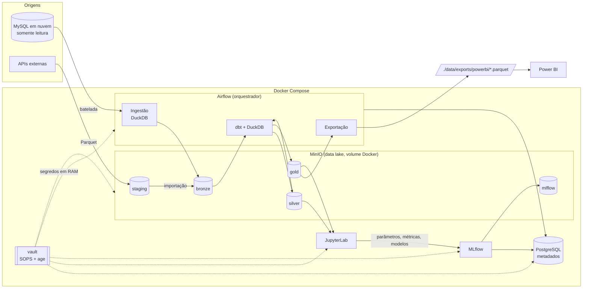

# CAPS — plataforma de dados com arquitetura medalhão

Infraestrutura completa, em Docker, para uma pipeline de dados de ponta a ponta: ingestão em
batelada de um **MySQL** em nuvem e de **APIs**, transformação em camadas **Bronze → Prata → Ouro**
com **DuckDB + dbt**, armazenamento em um **data lake MinIO**, orquestração com **Airflow**,
ciência de dados com **Jupyter + MLflow** e exportação em **Parquet para o Power BI**.

Tudo sobe com um comando:

```bash
docker compose up -d --build
```

> Cada pasta tem um `README.md` explicando o papel dela na arquitetura. Este é o ponto de partida.

---

## 1. Arquitetura



### Fluxo do dado

| Etapa | De → para | Quem executa | Local |
|---|---|---|---|
| 1 | MySQL → **Bronze** | DAG `bronze_mysql_ingestion` (DuckDB lê o MySQL em lotes e grava um Parquet por lote; tabelas divididas são unificadas) | `s3://bronze/mysql/<dataset>/ingestion_date=.../` |
| 1' | API → **Staging** → **Bronze** | DAG `example_api_to_bronze` (modelo para novas APIs) | `s3://staging/...` → `s3://bronze/<fonte>/...` |
| 2 | Bronze → **Prata** | DAG `dbt_medallion` (dbt + DuckDB) | `s3://silver/<modelo>.parquet` |
| 3 | Prata → **Ouro** | DAG `dbt_medallion` | `s3://gold/<modelo>.parquet` |
| 4 | Ouro → **Power BI** | DAG `gold_export_powerbi` | `./data/exports/powerbi/<modelo>.parquet` (fora do Docker) |
| 5 | Prata/Ouro → **modelos de ML** | Jupyter + MLflow | Postgres (parâmetros/métricas) + `s3://mlflow/` (modelos) |
| 6 | Prata → **seleção dos modelos de previsão** | DAG `ml_forecast_selection` (Baseline 3, ML e DL de `ml_models/`, backtest com corte M-2, campeão por alvo no *model registry*) | MLflow + `s3://gold/gld_forecast_*.parquet` |
| 7 | Campeões → **previsão do mês seguinte** | DAG `ml_forecast_next_month` (recebe o orçamento de mídia paga do mês) | MLflow + `s3://gold/gld_forecast_next_month*.parquet` |

As DAGs se encadeiam por *Assets*: quando a bronze é atualizada o dbt roda; quando a gold é
atualizada a exportação e a seleção dos modelos de previsão rodam (a seleção pula quando a silver
não mudou); quando as tabelas de previsão mudam, a exportação roda de novo.

### Componentes

| Serviço | Papel | Endereço | Persistência |
|---|---|---|---|
| `vault` | Cofre: descriptografa os segredos para um volume em memória | — | `./secrets` (arquivo criptografado) |
| `postgres` | Metadados do Airflow e do MLflow | interno | volume `postgres-data` |
| `minio` | Data lake S3 (staging, bronze, silver, gold, mlflow) | API http://localhost:9000 · console http://localhost:9001 | volume `minio-data` |
| `lake-init` | Cria os buckets (roda e termina) | — | — |
| `airflow-*` | Orquestração e execução das pipelines | http://localhost:8080 | volumes `airflow-logs`, `duckdb-data` |
| `mlflow` | Tracking de experimentos e Model Registry | http://localhost:5000 | Postgres + MinIO |
| `jupyter` | Notebooks para exploração e ML | http://localhost:8888 | `./notebooks` |

---

## 2. Pré-requisitos

- **Docker Desktop** (Windows/macOS) ou Docker Engine + plugin Compose v2 (Linux). No Windows, o
  Docker Desktop exige o **WSL 2** (`wsl --install`).
- Cerca de **8 GB de RAM** disponíveis para o Docker e ~10 GB de disco para as imagens.
- Acesso de rede da sua máquina ao MySQL de origem (liberação de IP/firewall, se houver).
- Internet no primeiro `build` (download das imagens e pacotes).

## 3. Primeira execução

```bash
# 1) Constrói as imagens e sobe tudo. Na primeira vez o cofre gera a chave e as senhas internas.
docker compose up -d --build

# 2) Acompanhe até todos ficarem "healthy" (lake-init e airflow-init terminam com "exited (0)").
docker compose ps

# 3) Informe as credenciais do MySQL de origem (o valor é pedido sem aparecer na tela).
docker compose run --rm vault set MYSQL_HOST
docker compose run --rm vault set MYSQL_DATABASE
docker compose run --rm vault set MYSQL_USER
docker compose run --rm vault set MYSQL_PASSWORD
docker compose run --rm vault set MYSQL_PORT

# 4) Aplique os segredos nos containers.
docker compose up -d --force-recreate
```

**Faça backup de `secrets/keys/age.key`** assim que ela for criada. Detalhes em
[`secrets/README.md`](secrets/README.md).

### Credenciais de acesso

| Interface | Usuário | Senha / token |
|---|---|---|
| Airflow — http://localhost:8080 | `admin` | `docker compose run --rm vault get AIRFLOW_ADMIN_PASSWORD` |
| MinIO console — http://localhost:9001 | `docker compose run --rm vault get LAKE_S3_ACCESS_KEY` | `docker compose run --rm vault get LAKE_S3_SECRET_KEY` |
| JupyterLab — http://localhost:8888 | — | `docker compose run --rm vault get JUPYTER_TOKEN` |
| MLflow — http://localhost:5000 | sem autenticação | — |

### Checklist de validação (recomendado na primeira subida)

1. `docker compose ps` — todos os serviços `running`/`healthy`; `lake-init` e `airflow-init` com saída 0.
2. `docker compose logs vault` — lista de segredos renderizados e eventuais pendências (`CHANGE_ME`).
3. Airflow → DAG **`mysql_test_query`** → *Trigger* → log da task `preview_table` mostra colunas e
   linhas de uma tabela do seu banco.
4. Airflow → ative `dbt_medallion` e `gold_export_powerbi` → *Trigger* em **`example_api_to_bronze`**.
   Ao final deve existir `data/exports/powerbi/gld_example_weather_daily.parquet`.
5. Jupyter → `01_quickstart_lake_mlflow.ipynb` → *Run All* → o experimento aparece no MLflow.

Se algum passo falhar, `docker compose logs <serviço>` e o log da task no Airflow mostram a causa.

---

## 4. Estrutura do projeto

```
CAPS/
├── docker-compose.yml        # todos os serviços, volumes e dependências
├── .env                      # configuração NÃO sensível (versões, portas, buckets, fuso)
├── CLAUDE.md                 # briefing da arquitetura para assistentes de IA (regras para novas DAGs e modelos)
├── secrets/                  # cofre: template + arquivo criptografado + chave (ignorada pelo Git)
├── docker/                   # Dockerfiles e scripts das imagens
│   ├── vault/  airflow/  mlflow/  jupyter/  postgres/  common/
├── airflow/dags/             # DAGs (orquestração) e config/mysql_tables.yml
├── src/lakehouse/            # pacote Python compartilhado (DuckDB, ingestão, staging, exportação)
├── dbt/                      # projeto dbt: macros + models/bronze|silver|gold
├── notebooks/                # notebooks do Jupyter
├── data/exports/             # Parquets exportados para o Power BI (fora do Docker)
├── Parfois Dashboard.pbip    # dashboard Power BI (modelo em .SemanticModel/, relatório em .Report/) — seção 8
├── Open Parfois Dashboard.cmd  # abre o dashboard apontando para os Parquets desta cópia do repositório
└── open_dashboard.ps1        # script chamado pelo .cmd: reescreve o parâmetro GoldFolder e abre o .pbip
```

| Quero... | Vá para |
|---|---|
| guardar uma senha/token ou entender o cofre | [`secrets/README.md`](secrets/README.md) |
| carregar o MySQL na bronze em lotes e testar a carga | [`airflow/dags/README.md`](airflow/dags/README.md) |
| unificar tabelas ou ajustar o tamanho dos lotes | [`airflow/dags/config/README.md`](airflow/dags/config/README.md) |
| criar uma pipeline de API (staging) | [`airflow/dags/README.md`](airflow/dags/README.md) |
| criar modelos silver/gold | [`dbt/README.md`](dbt/README.md) |
| entender as funções Python | [`src/lakehouse/README.md`](src/lakehouse/README.md) |
| treinar e versionar modelos | [`notebooks/README.md`](notebooks/README.md) |
| importar no Power BI | [`data/exports/README.md`](data/exports/README.md) |
| abrir ou alterar o dashboard de apresentação | seção 8 deste README (`Parfois Dashboard.pbip`) |
| alterar imagens/dependências | [`docker/README.md`](docker/README.md) |
| desenvolver com um assistente de IA (novas DAGs, modelos dbt) | [`CLAUDE.md`](CLAUDE.md) |

---

## 5. Decisões de arquitetura

| Tema | Decisão | Motivo |
|---|---|---|
| Bronze | MySQL é a **origem**; a bronze é materializada como Parquet no MinIO | as transformações não consultam o banco de produção; histórico e reprocessamento ficam no lake |
| Leitura do MySQL | extensão `mysql` do DuckDB, com a consulta executada no próprio MySQL e gravação direta em Parquet | *streaming* colunar, sem pandas nem carga completa em memória |
| Motor e transformações | DuckDB (motor) + dbt-duckdb (gestão), modelos `external` | SQL versionado e testado; resultado em Parquet aberto no lake |
| Staging | bucket próprio (`staging`), com expiração automática | área de pouso para APIs, separada das camadas; a importação para a bronze é uma etapa explícita |
| Orquestração | Airflow 3 com `LocalExecutor` e encadeamento por *Assets* | simples em um nó; troca de executor não exige mudar DAGs |
| Segredos | SOPS + age: arquivo criptografado + volume em memória no padrão `/run/secrets` | sem redigitar senhas, nada em texto puro no disco; compatível com Docker/K8s Secrets e KMS |
| Persistência | volumes Docker nomeados para MinIO, Postgres, DuckDB e logs | os dados sobrevivem à recriação dos containers |
| ML | Jupyter + MLflow (backend Postgres, artefatos no MinIO) | rastreabilidade e versionamento de modelos sem perda ao recriar containers |
| Previsão em produção | pacote `lakehouse.forecasting` rodando no virtualenv `/opt/ml-venv` da imagem do Airflow (torch CPU, scikit-learn, xgboost, cliente MLflow) | os modelos dos notebooks viram pipeline reprodutível, reavaliada quando os dados mudam, sem conflitar com as dependências do Airflow |
| Consumo | DAG exporta a gold em Parquet para uma pasta do host | o Power BI lê arquivos locais, sem acessar o Docker |

### Pronto para nuvem

A plataforma conversa com o armazenamento apenas via **API S3** e com os segredos apenas via
**arquivos em `/run/secrets`**. Para migrar:

- **MinIO → S3/GCS/ADLS**: altere `LAKE_S3_ENDPOINT`, `LAKE_S3_URL_STYLE` e as credenciais.
- **Cofre → KMS/Secrets Manager**: o SOPS aceita chaves de KMS; ou monte os segredos nativos do
  orquestrador de containers no mesmo caminho.
- **Postgres → serviço gerenciado**: altere `POSTGRES_HOST` e as senhas.
- **Airflow**: troque o executor (Celery/Kubernetes) ou use um serviço gerenciado; as DAGs não mudam.

---

## 6. Operação

```bash
docker compose ps                         # estado dos serviços
docker compose logs -f airflow-scheduler  # logs de um serviço
docker compose stop                       # para tudo, mantendo containers e dados
docker compose up -d                      # sobe novamente (sem pedir senhas)
docker compose down                       # remove containers; volumes e dados permanecem
docker compose down -v                    # APAGA também os volumes (lake, metadados, modelos)
docker compose up -d --force-recreate     # reaplica segredos / variáveis do .env
docker compose build <serviço>            # reconstrói uma imagem após mudar requirements
```

| Mudou... | Faça |
|---|---|
| DAG, código em `src/`, modelo dbt, notebook | nada — as pastas são montadas nos containers |
| um segredo | `docker compose up -d --force-recreate` |
| o `.env` | `docker compose up -d` |
| `requirements*.txt` ou script em `docker/` | `docker compose build <serviço> && docker compose up -d` |

### Limitações conhecidas

- **MinIO**: as imagens oficiais deixaram de ser distribuídas em 2026; o projeto usa a imagem
  gratuita da Chainguard (tag `latest`). Ver [`docker/README.md`](docker/README.md).
- **Um único nó**: `LocalExecutor` e arquivo DuckDB com um escritor por vez. Escala bem
  verticalmente; para paralelismo entre máquinas é preciso evoluir o executor e o motor.
- **MLflow sem autenticação** e todas as portas publicadas só em `127.0.0.1` (`BIND_ADDRESS`).
- **Modelos `external` do dbt** reescrevem o arquivo inteiro a cada execução.
- **Ingestão incremental** não captura exclusões feitas no MySQL.

## 7. Convenções do repositório

- Toda pasta tem um `README.md` (em português) explicando seu papel na arquitetura e cada arquivo.
- Código e comentários de código em **inglês**.
- Nenhum segredo em `docker-compose.yml`, `.env`, código ou imagens — apenas no cofre.
- Arquivos executados em containers usam fim de linha LF (`.gitattributes`).

## 8. Dashboard Power BI (`Parfois Dashboard.pbip`)

Relatório de apresentação, em inglês, no formato de projeto do Power BI (PBIP): o modelo semântico
fica em TMDL (`Parfois Dashboard.SemanticModel/`) e o relatório em PBIR (`Parfois Dashboard.Report/`).
Lê os Parquets de `data/exports/powerbi/` e segue o contrato de
[`dbt/models/gold/star_schema/README.md`](dbt/models/gold/star_schema/README.md), com nomes amigáveis.

| Item | Detalhe |
|---|---|
| Abrir | Dê dois cliques em `Open Parfois Dashboard.cmd`, não no `.pbip`. O Power Query só aceita caminhos absolutos, então o `.pbip` sozinho não acha `data\exports\powerbi` em outra máquina. O script `open_dashboard.ps1` grava no parâmetro `GoldFolder` o caminho dessa pasta na cópia do repositório em que ele está e abre o projeto. Com o Desktop aberto, ele recusa (feche antes). Em uma cópia nova não há `cache.abf`: depois de abrir, clique em *Atualizar*. |
| Páginas | Overview, Forecast, Sales quality, Marketing calendar e Markets & channels. Navegação pela barra lateral; filtros View, Period, Country e Origin sincronizados entre as páginas. |
| Período | Tabela desconectada `Month Selector`, com o filtro Period em hierarquia Ano → Mês. Sem escolha, o painel mostra o último mês completo; o item "Latest month" acompanha esse mês a cada carga. |
| Visão Month / Year | Botão View (tabela desconectada `Period View`). *Month* mostra o mês escolhido e o compara com o mês anterior e com o mesmo mês do ano anterior. *Year* mostra o acumulado do ano até o mês escolhido (clique no ano, ex. "2024", para o ano inteiro) e o compara com os mesmos meses do ano anterior. Os gráficos de 12 meses não mudam. A página Forecast é sempre mensal. |
| Budget | Tabela calculada `Budget Assumptions` (crescimento planejado por ano, editável no DATATABLE) e medida `[Revenue Budget]`: receita do ano anterior × (1 + crescimento planejado). Para 2024, cujo ano anterior não está nos dados, a base de 2023 é reconstruída pelo crescimento reportado (receita de 2024 ÷ 1,64). `[Budget Attainment]` = receita acumulada no ano ÷ budget anual; aparece no cartão Revenue da Overview. Premissas: 2024 +25% (realizado +64%), 2025 +40% (realizado +48%), 2026 +35%. |
| Modelo | As 11 tabelas do star schema (Sales, Marketing Activity, Date, Market, Origin, Movement Type, Product, Customer, Campaign Context, Event, Holiday), mais `Month Selector`, `Period View`, `Budget Assumptions` e `Metrics`, que guarda todas as medidas em pastas. |
| Pasta dos dados | Parâmetro `GoldFolder`, gravado pelo `open_dashboard.ps1` (ou à mão em *Transformar dados → Gerenciar parâmetros*). |
| Previsão | As medidas `Revenue Forecast (Model)`, `Orders Forecast (Model)` e `Units Sold Forecast (Model)` (pasta `5 Forecast\Model output (replace)`) são provisórias: base sazonal ingênua (mesmo mês do ano anterior × tendência recente). Troque o corpo delas pela saída do modelo de ML; as demais medidas de previsão e de acurácia leem essas três. |
| Mês recente | As devoluções entram até ~30 dias depois do fim do mês. Por isso a receita e a taxa de devolução do último mês são provisórias, e o subtítulo marca "(provisional)". |
| Uplift de eventos e feriados | Compara a receita dos dias de evento ou feriado com um dia normal dos mesmos mercados no mesmo período, para que mercados grandes e pequenos não se misturem. |
| Mapa | Não usado: Espanha e Portugal somam ~70% da receita, vários países têm mais de um canal (ex.: Online ES e El Corte Inglés) e os mercados pequenos sumiriam no mapa. A tabela ordenada da página Markets compara melhor. |
| Atualizar | *Página Inicial → Atualizar* depois que a DAG `gold_export_powerbi` rodar. Mantenha desligadas a importação e a detecção automática de relacionamentos (*Arquivo → Opções → Arquivo atual → Carregamento de dados*): ligadas, a atualização falha com "referência cíclica". |
| Git | `.pbi/cache.abf` (dados importados) e `.pbi/localSettings.json` ficam fora do Git (`.gitignore`). |

