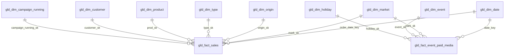

# `dbt/models/gold/star_schema/` — *star schema* de vendas online e marketing

## Papel na arquitetura

Modelo dimensional (Kimball) da camada Ouro: analisa vendas, devoluções e cancelamentos e os cruza
com o contexto de marketing (mídia paga, eventos comerciais e feriados) por dia e por mercado. É o
modelo que o Power BI deve usar para relatórios; as tabelas `gld_ml_*` da pasta acima são só para
treino de ML.

Todos os modelos leem apenas a silver (ou outros modelos desta pasta) com `ref`. Como estão dentro
de `models/gold/`, recebem o *schema* e a *tag* `gold`, rodam na DAG `dbt_medallion` e são gravados
em `s3://gold/<modelo>.parquet`, de onde a `gold_export_powerbi` os copia para o Power BI.



## Conteúdo

Cada modelo tem ao lado um `.yml` (`_<nome>__gold.yml`) com a descrição das colunas e os testes.

| Modelo | Tipo | Uma linha é | Fonte |
|---|---|---|---|
| `gld_fact_sales.sql` | fato | um produto (versão) × tipo de movimento em um pedido | `slv_order_det` + `slv_order_cab` |
| `gld_fact_event_paid_media.sql` | fato | um mercado × dia × evento × feriado | `slv_paid_media`, `slv_events`, `gld_dim_holiday` |
| `gld_dim_date.sql` | dimensão conformada | um dia de 2020-01-01 a 2026-12-31 + linha 0 | `slv_calendar` |
| `gld_dim_market.sql` | dimensão conformada | um código de mercado (chaves 0-34 fixas) | `slv_order_cab`, `slv_paid_media`, `slv_events`, `gld_ref_countries` |
| `gld_dim_origin.sql` | dimensão | uma combinação origem × plataforma (chaves 0-6 fixas) | `slv_order_cab` |
| `gld_dim_type.sql` | dimensão | um tipo de movimento (chaves 0-3 fixas) | `slv_order_det` |
| `gld_dim_product.sql` | dimensão SCD2 | uma versão de um SKU | `slv_product` (+ membros inferidos de `slv_order_det`) |
| `gld_dim_customer.sql` | dimensão SCD2 | uma versão de um cliente | `slv_customers` (+ membros inferidos de `slv_order_cab`) |
| `gld_dim_campaign_running.sql` | dimensão gerada | uma combinação das 3 *flags* (8 linhas + 0) | gerada no modelo |
| `gld_dim_event.sql` | dimensão | um evento (chaves 0-33 fixas) | `slv_events` |
| `gld_dim_holiday.sql` | dimensão | um feriado em um país e data + linha 0 | `slv_holidays` |
| `gld_ref_countries.sql` | *lookup* | um país (código ISO → nome) | lista no modelo |

## Convenções

- **Chaves:** toda dimensão tem um `_sk` inteiro como PK; a `gld_dim_date` usa a *smart key*
  `date_key` (AAAAMMDD). **Membro desconhecido = 0 em todas as dimensões** (busca que falhou,
  valor ausente ou "não se aplica", como dia sem evento).
- **Chaves fixas:** mercado, origem, tipo, evento e campanha têm as chaves da especificação escritas
  no próprio modelo, para não mudarem entre execuções. Um valor novo na origem recebe a próxima
  chave livre, sem apagar nada.
- **Membros inferidos:** produtos e clientes que aparecem nos pedidos mas não existem na tabela de
  origem viram linhas com `is_inferred = true` e atributos `Unknown`.
- **Relacionamentos:** sempre muitos → 1, filtro em direção única da dimensão para a fato.
  Dimensões não se ligam entre si e as duas fatos se cruzam só por `gld_dim_date` e
  `gld_dim_market`. A `gld_ref_countries` não se relaciona com nada no Power BI.
- **Auditoria:** as colunas de linhagem (`_ingested_at`, `_batch_id`) ficam na silver. A única
  coluna técnica da gold é `gld_fact_sales.n_source_lines`.

## SCD tipo 2

A origem é um único *snapshot*, então não há datas de validade reais:

- **Produto:** a própria origem já versiona o SKU. Cada `prod_cod` tem vários `prod_spk` (chave de
  versão para onde aponta `slv_order_det.prod_sfk`) e exatamente um com `active_record = true`,
  sempre o maior. Todas as linhas ficam válidas de 1900-01-01 a 9999-12-31 e
  `is_current = active_record`. A fato busca a versão por `prod_spk` + data do pedido.
- **Cliente:** o `newsletter_status` é atualizado no lugar (assinou → Subscribed, cancelou →
  Unsubscribed, sem linha nova). Só a **reassinatura** abre uma versão: quando
  `UNSUBSCRIPTION_DATE` é anterior a `SUBSCRIPTION_DATE`, o cliente tem uma versão Unsubscribed até a
  véspera da nova assinatura e outra Subscribed a partir dela. A fato busca a versão por
  `customer_id` + data do pedido.

A DAG `gold_scd2_simulation` simula mudanças futuras (fechar a versão atual e abrir outra) em uma
área separada do lake, `s3://gold/_simulation/`, sem alterar estes modelos. Ver
[`airflow/dags/README.md`](../../../../airflow/dags/README.md).

Testes próprios (em `dbt/macros/test_helpers.sql`): `unique_combination` (PK composta das fatos e
"uma versão corrente por chave natural") e `scd2_versions` (versões contínuas, de 1900-01-01 a
9999-12-31, sem buraco nem sobreposição).

## Decisões de carga

| Ponto | Regra adotada |
|---|---|
| Evento com `mark_cod = 'All'` | uma linha para cada mercado `Online ...`, exceto `Online ND` (os eventos são do parfois.com) |
| Evento `Apagão Ibérico` | fora da `gld_dim_event` e da fato (não é campanha comercial). Lista `excluded_events` no modelo |
| Nome do evento | chave normalizada pela macro `event_key`, igual à da `gld_ml_sales` (`Black Friday` → `black_friday`) |
| Feriados na fato | nacionais e regionais; só os nacionais contam em `gld_dim_campaign_running.is_holiday` |
| Eventos e feriados no mesmo dia e mercado | cada evento é combinado com cada feriado; `amount_paid_media` fica só na linha de menor `event_sk` e `holiday_sk` |
| Intervalo de datas | `gld_dim_date` e as fatos vão de `gold_date_start` a `gold_date_end` (`dbt_project.yml`). Feriados de 2027 ficam na `gld_dim_holiday`, mas não na fato |
| Linha de pedido sem cabeçalho | mantida, com todas as chaves do cabeçalho = 0 |
| `customer_id_fk = -1` | `customer_sk = 0` (franquia, sem ID) |
| Valores | `decimal(18,5)` nas duas fatos (a especificação pedia `decimal(18,2)`). Com 2 casas, o arredondamento por linha deixava o total de vendas ~730 € acima da silver; com 5 os totais batem com `slv_order_det` e `slv_paid_media`. Formate com 2 casas no Power BI |
| `date_label` | texto `AAAA-MM-DD` (a `slv_calendar` usa `DD/MM/AAAA`) |

## Relacionamentos no Power BI

| De (muitos) | Para (um) |
|---|---|
| `gld_fact_sales.order_date_key` | `gld_dim_date.date_key` |
| `gld_fact_sales.prod_sk` | `gld_dim_product.prod_sk` |
| `gld_fact_sales.type_sk` | `gld_dim_type.type_sk` |
| `gld_fact_sales.customer_sk` | `gld_dim_customer.customer_sk` |
| `gld_fact_sales.mark_sk` | `gld_dim_market.mark_sk` |
| `gld_fact_sales.origin_sk` | `gld_dim_origin.origin_sk` |
| `gld_fact_sales.campaign_running_sk` | `gld_dim_campaign_running.campaign_running_sk` |
| `gld_fact_event_paid_media.date_key` | `gld_dim_date.date_key` |
| `gld_fact_event_paid_media.mark_sk` | `gld_dim_market.mark_sk` |
| `gld_fact_event_paid_media.event_sk` | `gld_dim_event.event_sk` |
| `gld_fact_event_paid_media.holiday_sk` | `gld_dim_holiday.holiday_sk` |

## KPIs (calculados no relatório, por data do pedido)

A fato tem uma linha por produto: contar linhas conta linhas de produto. Para pedidos e clientes use
`COUNT(DISTINCT order_id)` e `COUNT(DISTINCT customer_sk)`. `valor` = `amount_fixed_rate_w_disc_wo_vat`.

| KPI | Fórmula |
|---|---|
| Gross sales | soma de `valor` onde `type = SALE` |
| Returns | soma de `valor` onde `type = RETURN` (negativo) |
| Cancellations | soma de `valor` onde `type = CANCELLED` (negativo) |
| Shipped sales | Gross sales + Cancellations |
| Net sales | soma de `valor` em todas as linhas (muda por ~30 dias após o fim do mês) |
| Units sold | soma de `prod_qty` onde `type = SALE` |
| Orders | `COUNT(DISTINCT order_id)` onde `type = SALE` |
| Average order value | Net sales ÷ Orders |
| Return rate | −Returns ÷ Gross sales |
| Discount rate | 1 − soma de `valor` ÷ soma de `amount_fixed_rate_wo_disc_wo_vat` |
| Sales under campaign | Net sales onde `campaign_label` não é `No` nem `Unknown` ÷ Net sales |

## Como validar

```bash
docker compose exec airflow-scheduler bash -c 'cd $DBT_PROJECT_DIR && unset PYTHONPATH && $DBT_BIN build --select path:models/gold/star_schema'
```
