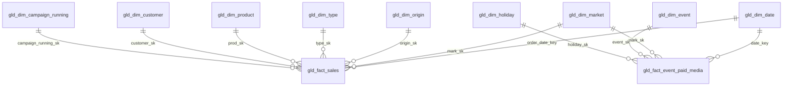

# `dbt/models/gold/star_schema/` — *star schema* de vendas online e marketing

## Papel na arquitetura

Modelo dimensional (Kimball) da camada Ouro: analisa vendas, devoluções e cancelamentos e os cruza
com o contexto de marketing (mídia paga, eventos comerciais e feriados) por dia e por mercado. É o
modelo que o Power BI deve usar para relatórios; as tabelas `gld_ml_*` da pasta acima são só para
treino de ML.

Todos os modelos leem apenas a silver (ou outros modelos desta pasta) com `ref`. Como estão dentro
de `models/gold/`, recebem o *schema* e a *tag* `gold`, rodam na DAG `dbt_medallion` e são gravados
em `s3://gold/<modelo>.parquet`, de onde a `gold_export_powerbi` os copia para o Power BI.



## Conteúdo

Cada modelo tem ao lado um `.yml` (`_<nome>__gold.yml`) com a descrição das colunas e os testes.

| Modelo | Tipo | Uma linha é | Fonte |
|---|---|---|---|
| `gld_fact_sales.sql` | fato | um produto (versão) × tipo de movimento em um pedido | `slv_order_det` + `slv_order_cab` |
| `gld_fact_event_paid_media.sql` | fato | um mercado × dia × evento × feriado | `slv_paid_media`, `slv_events`, `gld_dim_holiday` |
| `gld_dim_date.sql` | dimensão conformada | um dia de 2020-01-01 a 2026-12-31 + linha 0 | `slv_calendar` |
| `gld_dim_market.sql` | dimensão conformada | um código de mercado (chaves 0-34 fixas) | `slv_order_cab`, `slv_paid_media`, `slv_events`, `gld_ref_countries` |
| `gld_dim_origin.sql` | dimensão | uma combinação origem × plataforma (chaves 0-6 fixas) | `slv_order_cab` |
| `gld_dim_type.sql` | dimensão | um tipo de movimento (chaves 0-3 fixas) | `slv_order_det` |
| `gld_dim_product.sql` | dimensão SCD2 | uma versão de um SKU | `slv_product` (+ membros inferidos de `slv_order_det`) |
| `gld_dim_customer.sql` | dimensão SCD2 | uma versão de um cliente | `slv_customers` (+ membros inferidos de `slv_order_cab`) |
| `gld_dim_campaign_running.sql` | dimensão gerada | uma combinação das 3 *flags* (8 linhas + 0) | gerada no modelo |
| `gld_dim_event.sql` | dimensão | um evento (chaves 0-33 fixas) | `slv_events` |
| `gld_dim_holiday.sql` | dimensão | um feriado em um país e data + linha 0 | `slv_holidays` |
| `gld_ref_countries.sql` | *lookup* | um país (código ISO → nome) | lista no modelo |

## Convenções

- **Chaves:** toda dimensão tem um `_sk` inteiro como PK; a `gld_dim_date` usa a *smart key*
  `date_key` (AAAAMMDD). **Membro desconhecido = 0 em todas as dimensões** (busca que falhou,
  valor ausente ou "não se aplica", como dia sem evento).
- **Chaves fixas:** mercado, origem, tipo, evento e campanha têm as chaves da especificação escritas
  no próprio modelo, para não mudarem entre execuções. Um valor novo na origem recebe a próxima
  chave livre, sem apagar nada.
- **Membros inferidos:** produtos e clientes que aparecem nos pedidos mas não existem na tabela de
  origem viram linhas com `is_inferred = true` e atributos `Unknown`.
- **Relacionamentos:** sempre muitos → 1, filtro em direção única da dimensão para a fato.
  Dimensões não se ligam entre si e as duas fatos se cruzam só por `gld_dim_date` e
  `gld_dim_market`. A `gld_ref_countries` não se relaciona com nada no Power BI.
- **Auditoria:** as colunas de linhagem (`_ingested_at`, `_batch_id`) ficam na silver. A única
  coluna técnica da gold é `gld_fact_sales.n_source_lines`.

## SCD tipo 2

A origem é um único *snapshot*, então não há datas de validade reais:

- **Produto:** a própria origem já versiona o SKU. Cada `prod_cod` tem vários `prod_spk` (chave de
  versão para onde aponta `slv_order_det.prod_sfk`) e exatamente um com `active_record = true`,
  sempre o maior. Todas as linhas ficam válidas de 1900-01-01 a 9999-12-31 e
  `is_current = active_record`. A fato busca a versão por `prod_spk` + data do pedido.
- **Cliente:** o `newsletter_status` é atualizado no lugar (assinou → Subscribed, cancelou →
  Unsubscribed, sem linha nova). Só a **reassinatura** abre uma versão: quando
  `UNSUBSCRIPTION_DATE` é anterior a `SUBSCRIPTION_DATE`, o cliente tem uma versão Unsubscribed até a
  véspera da nova assinatura e outra Subscribed a partir dela. A fato busca a versão por
  `customer_id` + data do pedido.

A DAG `gold_scd2_simulation` simula mudanças futuras (fechar a versão atual e abrir outra) em uma
área separada do lake, `s3://gold/_simulation/`, sem alterar estes modelos. Ver
[`airflow/dags/README.md`](../../../../airflow/dags/README.md).

Testes próprios (em `dbt/macros/test_helpers.sql`): `unique_combination` (PK composta das fatos e
"uma versão corrente por chave natural") e `scd2_versions` (versões contínuas, de 1900-01-01 a
9999-12-31, sem buraco nem sobreposição).

## Decisões de carga

| Ponto | Regra adotada |
|---|---|
| Evento com `mark_cod = 'All'` | uma linha para cada mercado `Online ...`, exceto `Online ND` (os eventos são do parfois.com) |
| Evento `Apagão Ibérico` | fora da `gld_dim_event` e da fato (não é campanha comercial). Lista `excluded_events` no modelo |
| Nome do evento | chave normalizada pela macro `event_key`, igual à da `gld_ml_sales` (`Black Friday` → `black_friday`) |
| Feriados na fato | nacionais e regionais; só os nacionais contam em `gld_dim_campaign_running.is_holiday` |
| Eventos e feriados no mesmo dia e mercado | cada evento é combinado com cada feriado; `amount_paid_media` fica só na linha de menor `event_sk` e `holiday_sk` |
| Intervalo de datas | `gld_dim_date` e as fatos vão de `gold_date_start` a `gold_date_end` (`dbt_project.yml`). Feriados de 2027 ficam na `gld_dim_holiday`, mas não na fato |
| Linha de pedido sem cabeçalho | mantida, com todas as chaves do cabeçalho = 0 |
| `customer_id_fk = -1` | `customer_sk = 0` (franquia, sem ID) |
| Valores | `decimal(18,5)` nas duas fatos (a especificação pedia `decimal(18,2)`). Com 2 casas, o arredondamento por linha deixava o total de vendas ~730 € acima da silver; com 5 os totais batem com `slv_order_det` e `slv_paid_media`. Formate com 2 casas no Power BI |
| `date_label` | texto `AAAA-MM-DD` (a `slv_calendar` usa `DD/MM/AAAA`) |

## KPIs (definição de negócio, por data do pedido)

A fato tem uma linha por produto: contar linhas conta linhas de produto. Conte pedidos com
`COUNT(DISTINCT order_id)` e clientes com `COUNT(DISTINCT customer_id)` da `gld_dim_customer`. O
`customer_sk` muda a cada versão SCD2, então contá-lo conta versões, não pessoas.
`valor` = `amount_fixed_rate_w_disc_wo_vat`.

| KPI | Fórmula |
|---|---|
| Gross sales | soma de `valor` onde `type = SALE` |
| Returns | soma de `valor` onde `type = RETURN` (negativo) |
| Cancellations | soma de `valor` onde `type = CANCELLED` (negativo) |
| Shipped sales | Gross sales + Cancellations |
| Net sales | soma de `valor` em todas as linhas (muda por ~30 dias após o fim do mês) |
| Units sold | soma de `prod_qty` onde `type = SALE` |
| Orders | `COUNT(DISTINCT order_id)` onde `type = SALE` |
| Average order value | Net sales ÷ Orders |
| Return rate | −Returns ÷ Gross sales |
| Discount rate | 1 − soma de `valor` ÷ soma de `amount_fixed_rate_wo_disc_wo_vat` |
| Sales under campaign | Net sales onde `campaign_label` não é `No` nem `Unknown` ÷ Net sales |

As medidas DAX equivalentes estão no passo 6 da seção seguinte.

## Integração com o Power BI

Esta seção é o contrato do modelo semântico: com ela, uma pessoa ou um assistente monta o modelo
do Power BI sem consultar outro arquivo. As tabelas e colunas do Power BI têm exatamente os nomes
dos arquivos e das colunas abaixo. A descrição de cada coluna está no `_<modelo>__gold.yml` desta
pasta e pode ir para o campo *Descrição* da coluna no Power BI.

O dashboard de apresentação (`Parfois Dashboard.pbip`, na raiz do repositório; ver a seção 8 do
README principal) implementa este contrato com nomes amigáveis em inglês. O `sourceColumn` de cada
coluna continua sendo o nome da coluna no Parquet:

| Modelo | Tabela no dashboard |
|---|---|
| `gld_fact_sales` | `Sales` |
| `gld_fact_event_paid_media` | `Marketing Activity` |
| `gld_dim_date` | `Date` |
| `gld_dim_market` | `Market` (+ colunas `Region` e `Market Channel`, criadas no Power Query) |
| `gld_dim_origin` | `Origin` (`Origin`, `Origin Type` e `Platform` com rótulos legíveis) |
| `gld_dim_type` | `Movement Type` |
| `gld_dim_product` | `Product` |
| `gld_dim_customer` | `Customer` (só chave, ID, país, newsletter e origem da inscrição) |
| `gld_dim_campaign_running` | `Campaign Context` (`No` aparece como `No campaign`) |
| `gld_dim_event` | `Event` (nome do evento e tipo legíveis) |
| `gld_dim_holiday` | `Holiday` |

Fora do star schema, o dashboard também carrega as tabelas de previsão gravadas por Python
(`src/lakehouse/forecasting/`): `gld_forecast_champion` → `Forecast Target`,
`gld_forecast_model_metrics` → `Forecast Model`, `gld_forecast_backtest_monthly` →
`Forecast Backtest` e `gld_forecast_next_month` → `Forecast Next Month`. Elas se ligam a `Date` pela
chave do mês (`month_date_key`) e a uma tabela calculada `Forecast Market` (ES + PT, Online ES,
Online PT) pela coluna `market`; não se ligam a `Market`.

### 1. Origem dos dados

| Item | Definição |
|---|---|
| Arquivos | `data/exports/powerbi/<modelo>.parquet` no host, gravados pela DAG `gold_export_powerbi` (cópia de `s3://gold/<modelo>.parquet`). Um arquivo por tabela; nome do arquivo = nome da tabela |
| Tabelas a carregar | as 11 do star schema: `gld_fact_sales`, `gld_fact_event_paid_media`, `gld_dim_date`, `gld_dim_market`, `gld_dim_origin`, `gld_dim_type`, `gld_dim_product`, `gld_dim_customer`, `gld_dim_campaign_running`, `gld_dim_event`, `gld_dim_holiday` |
| Não carregar | `gld_ref_countries` (o nome do país já está em `gld_dim_market`), `gld_ml_sales` e `gld_ml_orders` (treino de ML), `gld_weather_country_daily` e `gld_example_*` (fora do star schema) |
| Modo de armazenamento | Importação (o conector Parquet não tem DirectQuery) |
| Onde o Power BI roda | o Power BI Desktop só roda no Windows e a plataforma roda em Docker (hoje num host Linux). Leve a pasta até o Windows: cópia, pasta de rede (`\\servidor\...`) ou OneDrive/SharePoint. No Power BI Service, arquivo local exige *gateway*; SharePoint/OneDrive não |
| Volume (carga de 20/11/2026) | `gld_fact_sales` 9.010.634 linhas (147 MB), `gld_dim_customer` 7.888.952 (90 MB), `gld_dim_product` 246.824; as demais têm menos de 25 mil. As contagens atuais estão em `data/exports/powerbi/_manifest.json` |

Não use *Obter dados → Pasta* com *Combinar arquivos*: ele empilharia todos os Parquets numa tabela só.

### 2. Parâmetros e consultas (Power Query M)

Parâmetros (*Transformar dados → Gerenciar parâmetros*):

| Parâmetro | Tipo | Valor | Uso |
|---|---|---|---|
| `PastaGold` | Texto | pasta `data\exports\powerbi\` com a barra no final, ex. `C:\CAPS\data\exports\powerbi\` | todas as tabelas |
| `PastaSimulacao` | Texto | pasta de um cenário, ex. `C:\CAPS\data\exports\scd2_simulation\demo\` | simulação SCD2 (passo 9) |
| `UsarSimulacao` | Verdadeiro/Falso | `false` | liga a simulação SCD2 |

Uma consulta por tabela, com o nome da tabela. As 7 tabelas sem regra especial (`gld_dim_market`,
`gld_dim_origin`, `gld_dim_type`, `gld_dim_campaign_running`, `gld_dim_event`, `gld_dim_holiday` e
`gld_fact_event_paid_media`) usam o padrão, trocando o nome do arquivo:

```m
let
    Origem = Parquet.Document(File.Contents(PastaGold & "gld_dim_market.parquet"))
in
    Origem
```

`gld_dim_date` sem a linha 0 (data nula), porque *Marcar como tabela de data* não aceita data em
branco. As linhas das fatos com data 0 (hoje, 236 linhas de pedido sem cabeçalho) aparecem como
*(Em branco)* nos visuais:

```m
let
    Origem = Parquet.Document(File.Contents(PastaGold & "gld_dim_date.parquet")),
    SemLinhaZero = Table.SelectRows(Origem, each [date_key] <> 0)
in
    SemLinhaZero
```

`gld_fact_sales`, `gld_dim_product` e `gld_dim_customer` leem o arquivo do cenário quando
`UsarSimulacao` está ligado e o cenário tem aquele arquivo; senão, leem a gold (troque `Arquivo`):

```m
let
    Arquivo = "gld_fact_sales.parquet",
    NaSimulacao = UsarSimulacao and List.Contains(Folder.Files(PastaSimulacao)[Name], Arquivo),
    Pasta = if NaSimulacao then PastaSimulacao else PastaGold,
    Origem = Parquet.Document(File.Contents(Pasta & Arquivo))
in
    Origem
```

As colunas `TINYINT` e `SMALLINT` da `gld_dim_date` ainda não foram testadas no Power BI. Se o
conector recusar alguma, troque o `cast` dela por `integer` em `gld_dim_date.sql`.

### 3. Dicionário de colunas

- **Tipo no Power BI**: o tipo a manter depois da carga.
- **Oculta = sim**: chaves e colunas que só alimentam medidas. Nos visuais usam-se atributos das
  dimensões e as medidas do passo 6.
- **Classificar por**: configure em *Classificar por coluna*.
- Em todas as dimensões, as colunas numéricas são atributos: *Resumir por = Nenhum*.

#### `gld_fact_sales`

| Coluna | Tipo no Parquet | Tipo no Power BI | Papel | Oculta | Classificar por |
|---|---|---|---|---|---|
| `order_id` | VARCHAR | Texto | PK (parte) · dimensão degenerada | não |  |
| `prod_sk` | INTEGER | Número inteiro | PK (parte) · FK → `gld_dim_product[prod_sk]` | sim |  |
| `type_sk` | INTEGER | Número inteiro | PK (parte) · FK → `gld_dim_type[type_sk]` | sim |  |
| `order_date_key` | INTEGER | Número inteiro | FK → `gld_dim_date[date_key]` | sim |  |
| `customer_sk` | INTEGER | Número inteiro | FK → `gld_dim_customer[customer_sk]` | sim |  |
| `mark_sk` | INTEGER | Número inteiro | FK → `gld_dim_market[mark_sk]` | sim |  |
| `origin_sk` | INTEGER | Número inteiro | FK → `gld_dim_origin[origin_sk]` | sim |  |
| `is_registered` | BOOLEAN | Verdadeiro/Falso | dimensão degenerada (flag) | não |  |
| `campaign_running_sk` | INTEGER | Número inteiro | FK → `gld_dim_campaign_running[campaign_running_sk]` | sim |  |
| `prod_qty` | INTEGER | Número inteiro | base de medida | sim |  |
| `amount_fixed_rate_w_disc_wo_vat` | DECIMAL(18,5) | Número decimal | base de medida | sim |  |
| `amount_fixed_rate_wo_disc_wo_vat` | DECIMAL(18,5) | Número decimal | base de medida | sim |  |
| `n_source_lines` | INTEGER | Número inteiro | auditoria | sim |  |

#### `gld_fact_event_paid_media`

| Coluna | Tipo no Parquet | Tipo no Power BI | Papel | Oculta | Classificar por |
|---|---|---|---|---|---|
| `date_key` | INTEGER | Número inteiro | PK (parte) · FK → `gld_dim_date[date_key]` | sim |  |
| `mark_sk` | INTEGER | Número inteiro | PK (parte) · FK → `gld_dim_market[mark_sk]` | sim |  |
| `event_sk` | INTEGER | Número inteiro | PK (parte) · FK → `gld_dim_event[event_sk]` | sim |  |
| `holiday_sk` | INTEGER | Número inteiro | PK (parte) · FK → `gld_dim_holiday[holiday_sk]` | sim |  |
| `amount_paid_media` | DECIMAL(18,5) | Número decimal | base de medida | sim |  |

#### `gld_dim_date`

| Coluna | Tipo no Parquet | Tipo no Power BI | Papel | Oculta | Classificar por |
|---|---|---|---|---|---|
| `calendar_date` | DATE | Data | atributo | não |  |
| `date_key` | INTEGER | Número inteiro | PK | sim |  |
| `day_of_month` | TINYINT | Número inteiro | atributo | não |  |
| `day_of_week` | TINYINT | Número inteiro | atributo | não |  |
| `day_of_week_name` | VARCHAR | Texto | atributo | não | `day_of_week` |
| `day_of_week_short` | VARCHAR | Texto | atributo | não | `day_of_week` |
| `day_of_year` | SMALLINT | Número inteiro | atributo | não |  |
| `date_label` | VARCHAR | Texto | atributo | não |  |
| `iso_week_of_year` | TINYINT | Número inteiro | atributo | não |  |
| `iso_year` | SMALLINT | Número inteiro | atributo | não |  |
| `iso_year_week` | VARCHAR | Texto | atributo | não |  |
| `week_start_date` | DATE | Data | atributo | não |  |
| `week_end_date` | DATE | Data | atributo | não |  |
| `month_number` | TINYINT | Número inteiro | atributo | não |  |
| `month_name` | VARCHAR | Texto | atributo | não | `month_number` |
| `month_short` | VARCHAR | Texto | atributo | não | `month_number` |
| `year_month_number` | INTEGER | Número inteiro | atributo | não |  |
| `year_month` | VARCHAR | Texto | atributo | não | `year_month_number` |
| `year_month_label` | VARCHAR | Texto | atributo | não | `year_month_number` |
| `month_start_date` | DATE | Data | atributo | não |  |
| `month_end_date` | DATE | Data | atributo | não |  |
| `days_in_month` | TINYINT | Número inteiro | atributo | não |  |
| `is_month_start` | BOOLEAN | Verdadeiro/Falso | atributo | não |  |
| `is_month_end` | BOOLEAN | Verdadeiro/Falso | atributo | não |  |
| `quarter_number` | TINYINT | Número inteiro | atributo | não |  |
| `quarter_label` | VARCHAR | Texto | atributo | não | `quarter_number` |
| `year_quarter_number` | INTEGER | Número inteiro | atributo | não |  |
| `year_quarter` | VARCHAR | Texto | atributo | não | `year_quarter_number` |
| `quarter_start_date` | DATE | Data | atributo | não |  |
| `quarter_end_date` | DATE | Data | atributo | não |  |
| `semester_number` | TINYINT | Número inteiro | atributo | não |  |
| `year_semester` | VARCHAR | Texto | atributo | não |  |
| `year_number` | SMALLINT | Número inteiro | atributo | não |  |
| `year_start_date` | DATE | Data | atributo | não |  |
| `year_end_date` | DATE | Data | atributo | não |  |
| `is_leap_year` | BOOLEAN | Verdadeiro/Falso | atributo | não |  |
| `is_weekend` | BOOLEAN | Verdadeiro/Falso | atributo | não |  |

#### `gld_dim_market`

| Coluna | Tipo no Parquet | Tipo no Power BI | Papel | Oculta | Classificar por |
|---|---|---|---|---|---|
| `mark_sk` | INTEGER | Número inteiro | PK | sim |  |
| `mark_cod` | VARCHAR | Texto | chave natural | não |  |
| `country_code` | VARCHAR | Texto | atributo | não |  |
| `country_name` | VARCHAR | Texto | atributo | não |  |

#### `gld_dim_origin`

| Coluna | Tipo no Parquet | Tipo no Power BI | Papel | Oculta | Classificar por |
|---|---|---|---|---|---|
| `origin_sk` | INTEGER | Número inteiro | PK | sim |  |
| `order_origin` | VARCHAR | Texto | chave natural | não |  |
| `order_chanel_type` | VARCHAR | Texto | chave natural | não |  |

#### `gld_dim_type`

| Coluna | Tipo no Parquet | Tipo no Power BI | Papel | Oculta | Classificar por |
|---|---|---|---|---|---|
| `type_sk` | INTEGER | Número inteiro | PK | sim |  |
| `type` | VARCHAR | Texto | chave natural | não |  |
| `type_desc` | VARCHAR | Texto | atributo | não | `type_sk` |

#### `gld_dim_product`

| Coluna | Tipo no Parquet | Tipo no Power BI | Papel | Oculta | Classificar por |
|---|---|---|---|---|---|
| `prod_sk` | INTEGER | Número inteiro | PK | sim |  |
| `prod_spk` | BIGINT | Número inteiro | chave de versão da origem (alvo de `prod_sfk`) | não |  |
| `prod_cod` | VARCHAR | Texto | chave natural | não |  |
| `cat_des_en` | VARCHAR | Texto | atributo (SCD tipo 0) | não |  |
| `gfa_des_en` | VARCHAR | Texto | atributo (SCD tipo 0) | não |  |
| `gfs_des_en` | VARCHAR | Texto | atributo (SCD tipo 0) | não |  |
| `collection_type` | VARCHAR | Texto | atributo (SCD tipo 0) | não |  |
| `sea_cod` | SMALLINT | Número inteiro | atributo (SCD tipo 0) | não |  |
| `active` | BOOLEAN | Verdadeiro/Falso | atributo (SCD tipo 2) | não |  |
| `fashiontype` | VARCHAR | Texto | atributo (SCD tipo 2) | não |  |
| `active_category` | BOOLEAN | Verdadeiro/Falso | atributo (SCD tipo 2) | não |  |
| `target_description` | VARCHAR | Texto | atributo (SCD tipo 0) | não |  |
| `valid_from` | DATE | Data | controle SCD2 | não |  |
| `valid_to` | DATE | Data | controle SCD2 | não |  |
| `is_current` | BOOLEAN | Verdadeiro/Falso | controle SCD2 | não |  |
| `is_inferred` | BOOLEAN | Verdadeiro/Falso | controle SCD2 | não |  |

#### `gld_dim_customer`

| Coluna | Tipo no Parquet | Tipo no Power BI | Papel | Oculta | Classificar por |
|---|---|---|---|---|---|
| `customer_sk` | INTEGER | Número inteiro | PK | sim |  |
| `customer_id` | BIGINT | Número inteiro | chave natural (conte clientes por ela) | não |  |
| `creation_date` | DATE | Data | atributo (SCD tipo 0) | não |  |
| `country` | VARCHAR | Texto | atributo (SCD tipo 1) | não |  |
| `subscription_date` | DATE | Data | atributo (SCD tipo 2) | não |  |
| `unsubscription_date` | DATE | Data | atributo (SCD tipo 2) | não |  |
| `newsletter_status` | VARCHAR | Texto | atributo (SCD tipo 1) | não |  |
| `subscription_source` | VARCHAR | Texto | atributo (SCD tipo 1) | não |  |
| `birthday` | DATE | Data | atributo (SCD tipo 0) · dado pessoal, só agregado | não |  |
| `valid_from` | DATE | Data | controle SCD2 | não |  |
| `valid_to` | DATE | Data | controle SCD2 | não |  |
| `is_current` | BOOLEAN | Verdadeiro/Falso | controle SCD2 | não |  |
| `is_inferred` | BOOLEAN | Verdadeiro/Falso | controle SCD2 | não |  |

#### `gld_dim_campaign_running`

| Coluna | Tipo no Parquet | Tipo no Power BI | Papel | Oculta | Classificar por |
|---|---|---|---|---|---|
| `campaign_running_sk` | INTEGER | Número inteiro | PK | sim |  |
| `has_paid_media` | BOOLEAN | Verdadeiro/Falso | atributo | não |  |
| `has_event` | BOOLEAN | Verdadeiro/Falso | atributo | não |  |
| `is_holiday` | BOOLEAN | Verdadeiro/Falso | atributo | não |  |
| `campaign_label` | VARCHAR | Texto | atributo | não | `campaign_running_sk` |

#### `gld_dim_event`

| Coluna | Tipo no Parquet | Tipo no Power BI | Papel | Oculta | Classificar por |
|---|---|---|---|---|---|
| `event_sk` | INTEGER | Número inteiro | PK | sim |  |
| `event` | VARCHAR | Texto | chave natural | não |  |
| `macro_event_type` | VARCHAR | Texto | atributo | não |  |

#### `gld_dim_holiday`

| Coluna | Tipo no Parquet | Tipo no Power BI | Papel | Oculta | Classificar por |
|---|---|---|---|---|---|
| `holiday_sk` | INTEGER | Número inteiro | PK | sim |  |
| `holiday_id` | VARCHAR | Texto | chave natural | não |  |
| `country_code` | VARCHAR | Texto | atributo | não |  |
| `is_nationwide` | BOOLEAN | Verdadeiro/Falso | atributo | não |  |
| `subdivision_codes` | VARCHAR | Texto | atributo | não |  |
| `holiday_date` | DATE | Data | atributo | não |  |
| `holiday_date_key` | INTEGER | Número inteiro | atributo (AAAAMMDD, sem relacionamento) | sim |  |
| `holiday_year` | INTEGER | Número inteiro | atributo | não |  |
| `holiday_name` | VARCHAR | Texto | atributo | não |  |
| `local_name` | VARCHAR | Texto | atributo | não |  |
| `holiday_types` | VARCHAR | Texto | atributo | não |  |
| `is_public` | BOOLEAN | Verdadeiro/Falso | atributo | não |  |

### 4. Relacionamentos

| De (muitos) | Para (um) | Cardinalidade | Direção do filtro | Ativo |
|---|---|---|---|---|
| `gld_fact_sales[order_date_key]` | `gld_dim_date[date_key]` | muitos para um (*:1) | única | sim |
| `gld_fact_sales[prod_sk]` | `gld_dim_product[prod_sk]` | muitos para um (*:1) | única | sim |
| `gld_fact_sales[type_sk]` | `gld_dim_type[type_sk]` | muitos para um (*:1) | única | sim |
| `gld_fact_sales[customer_sk]` | `gld_dim_customer[customer_sk]` | muitos para um (*:1) | única | sim |
| `gld_fact_sales[mark_sk]` | `gld_dim_market[mark_sk]` | muitos para um (*:1) | única | sim |
| `gld_fact_sales[origin_sk]` | `gld_dim_origin[origin_sk]` | muitos para um (*:1) | única | sim |
| `gld_fact_sales[campaign_running_sk]` | `gld_dim_campaign_running[campaign_running_sk]` | muitos para um (*:1) | única | sim |
| `gld_fact_event_paid_media[date_key]` | `gld_dim_date[date_key]` | muitos para um (*:1) | única | sim |
| `gld_fact_event_paid_media[mark_sk]` | `gld_dim_market[mark_sk]` | muitos para um (*:1) | única | sim |
| `gld_fact_event_paid_media[event_sk]` | `gld_dim_event[event_sk]` | muitos para um (*:1) | única | sim |
| `gld_fact_event_paid_media[holiday_sk]` | `gld_dim_holiday[holiday_sk]` | muitos para um (*:1) | única | sim |

Não existe nenhum outro relacionamento: dimensões não se ligam entre si, as duas fatos não se ligam
diretamente e `gld_dim_holiday` não se liga a `gld_dim_date`. Desligue *Arquivo → Opções →
Carregamento de dados → Detectar automaticamente novos relacionamentos* e apague qualquer
relacionamento criado sozinho, como `gld_dim_holiday[country_code]` com
`gld_dim_market[country_code]`. Todas as chaves das fatos existem nas dimensões (testes
`relationships` do dbt), então nenhuma linha cai em *(Em branco)*, exceto as de data 0 do passo 2.

### 5. Configurações do modelo

| Configuração | Valor |
|---|---|
| Data/hora automática | desligada (*Arquivo → Opções → Carregamento de dados*) |
| Tabela de data | `gld_dim_date`, marcada como tabela de data pela coluna `calendar_date` (intervalo contínuo de 2020-01-01 a 2026-12-31) |
| Formato de valores | `€ #,0.00` nas medidas de valor; `0.00%` nas taxas |
| Categoria de dados | `gld_dim_market[country_name]`: País/Região (mapas) |
| Membro desconhecido | linha 0 de cada dimensão, com rótulo `Unknown` (`No event` em `gld_dim_event`, `No holiday` em `gld_dim_holiday`). Em `gld_dim_date` ela é filtrada (passo 2) |
| Hierarquias sugeridas | data: `year_number` → `quarter_label` → `month_name` → `calendar_date`; produto: `cat_des_en` → `gfa_des_en` → `gfs_des_en` → `prod_cod`; origem: `order_origin` → `order_chanel_type` |

### 6. Medidas (DAX)

Medidas de vendas na tabela `gld_fact_sales`; as de mídia paga na `gld_fact_event_paid_media`.

```dax
-- gld_fact_sales · formato € #,0.00
Net Sales = SUM ( gld_fact_sales[amount_fixed_rate_w_disc_wo_vat] )
Gross Sales = CALCULATE ( [Net Sales], gld_dim_type[type] = "SALE" )
Returns = CALCULATE ( [Net Sales], gld_dim_type[type] = "RETURN" )
Cancellations = CALCULATE ( [Net Sales], gld_dim_type[type] = "CANCELLED" )
Shipped Sales = [Gross Sales] + [Cancellations]
Average Order Value = DIVIDE ( [Net Sales], [Orders] )

-- gld_fact_sales · formato #,0
Units Sold = CALCULATE ( SUM ( gld_fact_sales[prod_qty] ), gld_dim_type[type] = "SALE" )
Orders = CALCULATE ( DISTINCTCOUNT ( gld_fact_sales[order_id] ), gld_dim_type[type] = "SALE" )
Customers =
    CALCULATE (
        DISTINCTCOUNT ( gld_dim_customer[customer_id] ),
        gld_fact_sales,
        gld_dim_customer[customer_sk] <> 0
    )

-- gld_fact_sales · formato 0.00%
Return Rate = DIVIDE ( -[Returns], [Gross Sales] )
Discount Rate = 1 - DIVIDE ( [Net Sales], SUM ( gld_fact_sales[amount_fixed_rate_wo_disc_wo_vat] ) )
Sales Under Campaign % =
    DIVIDE (
        CALCULATE ( [Net Sales], NOT gld_dim_campaign_running[campaign_label] IN { "No", "Unknown" } ),
        [Net Sales]
    )

-- gld_fact_event_paid_media · formato € #,0.00 (a medida de razão: #,0.00)
Paid Media = SUM ( gld_fact_event_paid_media[amount_paid_media] )
Net Sales per Paid Media € = DIVIDE ( [Net Sales], [Paid Media] )
```

### 7. Regras de uso nos visuais

- **Visual com as duas fatos** (vendas × mídia paga, `Net Sales per Paid Media €`): use só colunas
  de `gld_dim_date` e `gld_dim_market`, as dimensões compartilhadas. Um filtro de produto, cliente
  ou evento não chega à outra fato.
- **Contagens:** pedidos com `[Orders]` e clientes com `[Customers]`, nunca contando linhas.
- **Eventos e feriados:** na `gld_fact_event_paid_media`, cada evento do dia é combinado com cada
  feriado. Conte eventos com `DISTINCTCOUNT(event_sk)`, nunca linhas. `SUM(amount_paid_media)` é
  seguro (o gasto fica numa linha só por mercado e dia).
- **Feriados:** a fato de marketing tem nacionais e regionais (`gld_dim_holiday[is_nationwide]`);
  o `is_holiday` da `gld_dim_campaign_running` conta só os nacionais.
- **SCD2:** o atributo de produto e de cliente mostrado com as vendas é o da data do pedido.
  `prod_cod` e `customer_id` agrupam todas as versões. Não filtre `is_current = true` em relatórios
  de vendas: isso corta as vendas das versões antigas.
- **Privacidade:** `gld_dim_customer[birthday]` só em agregados (faixa etária, mês de aniversário).

### 8. Atualização e conferência

- Fluxo: ingestão da bronze → `dbt_medallion` → asset `lake_gold` → `gold_export_powerbi`, que
  sobrescreve os arquivos de `data/exports/powerbi/`. Depois, *Atualizar* no Power BI. As duas DAGs
  precisam estar ativas.
- Feche o relatório durante a exportação: com o arquivo aberto, a troca falha.
- Conferência depois de carregar: as linhas de cada tabela devem bater com `_manifest.json`. Na
  carga de 20/11/2026: `[Net Sales]` total = 63.602.414,25 €, `[Paid Media]` total = 7.267.578,92 €
  e 3.977.998 valores distintos de `order_id` (todos os tipos). Os mesmos totais saem da silver no
  Jupyter, somando `amount_fixed_rate_w_disc_wo_vat` de `slv_order_det` e `amount_paid_media` de
  `slv_paid_media`.

### 9. Simulação SCD2 no Power BI

A DAG `gold_scd2_simulation` grava em `data/exports/scd2_simulation/<cenário>/` a última versão da
dimensão alterada e da `gld_fact_sales` (e `_history.json` com as mudanças do cenário). Para ver o
efeito, aponte `PastaSimulacao` para a pasta do cenário, ligue `UsarSimulacao` e atualize: as
consultas do passo 2 trocam só os arquivos que o cenário tem. Os demais arquivos da gold continuam
compatíveis, porque a simulação só altera as chaves do membro mudado.

## Como validar

```bash
docker compose exec airflow-scheduler bash -c 'cd $DBT_PROJECT_DIR && unset PYTHONPATH && $DBT_BIN build --select path:models/gold/star_schema'
```
